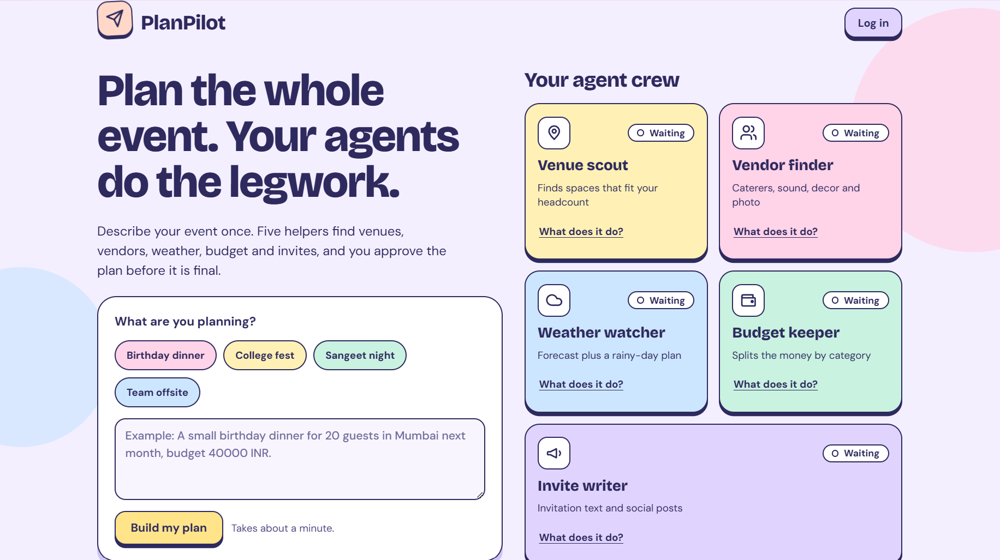
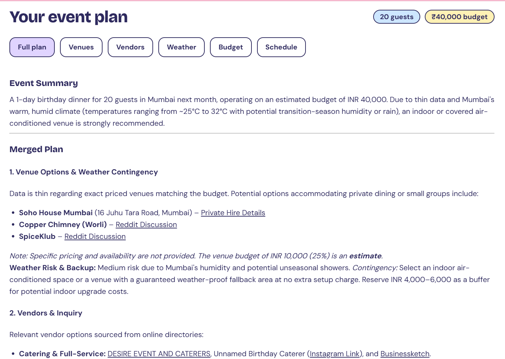
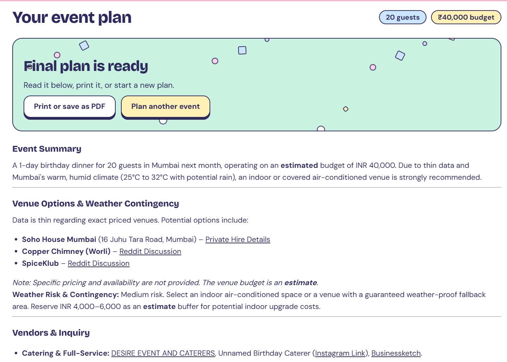
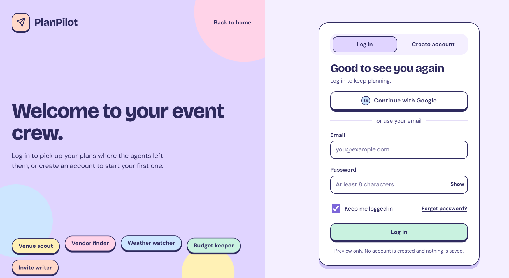
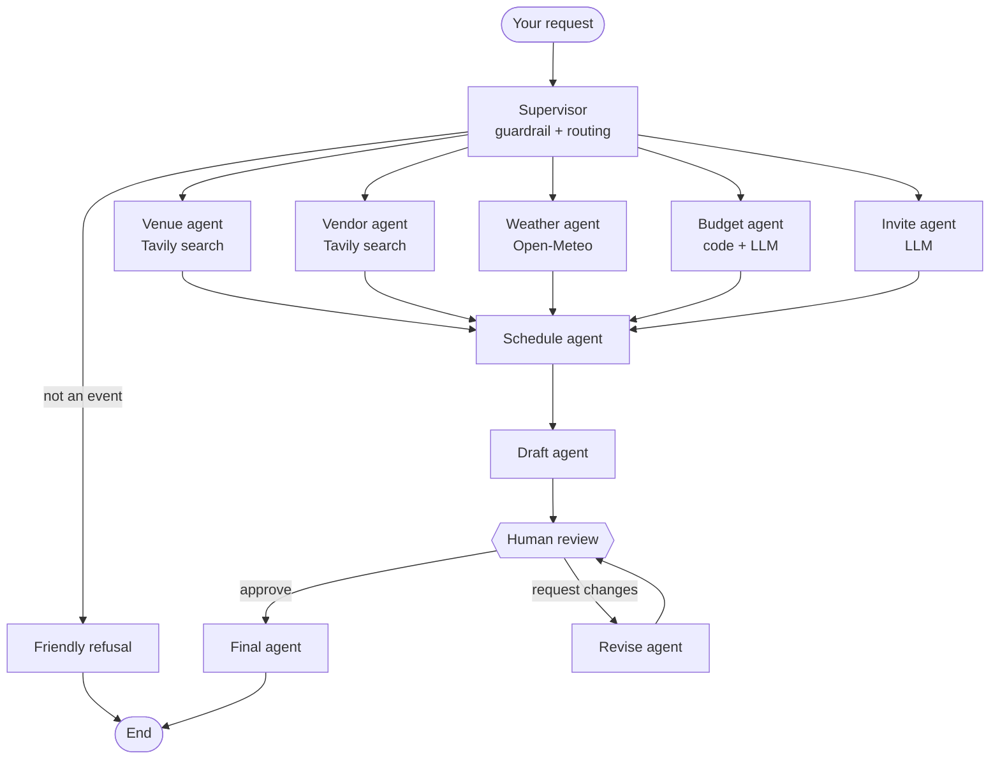

# PlanPilot

**A team of AI agents that plans your event, then waits for your approval.**


**Live demo:** [planpilot-y684.onrender.com](https://planpilot-y684.onrender.com/)
(The free host sleeps when idle, so the first load can take up to a minute.)

PlanPilot turns one sentence, like *"A 2-day college tech fest for 300 people in Indore, budget 150000 INR"*, into a complete event plan. A supervisor checks the request and sends it to specialist agents. They search for venues and vendors, check the weather, split the budget, and write invitations. You review the draft, ask for changes, and approve it before it becomes final.

---

## Screenshots

| Home | Plan with venue and vendor links |
|---|---|
|  |  |

| Final plan | Login page (preview) |
|---|---|
|  |  |

---

## Why PlanPilot?

Planning an event means juggling venue searches, vendor lists, weather, budgets and invitations in separate places. A single AI prompt tends to make up venue names and prices. PlanPilot splits the work across focused agents, uses real search results for names and links, calculates the budget with code instead of guessing, and keeps a human in charge of the final decision.

## How it works

1. **You describe the event** in plain language, or pick an example.
2. **The supervisor** checks that it is an event request, pulls out the city, date, headcount and budget, and chooses which agents to run. Off-topic requests get a polite refusal.
3. **Five agents work in parallel:** venues, vendors, weather, budget and invitations.
4. **The schedule agent** builds a timeline, and **the draft agent** merges everything into one plan.
5. **The workflow pauses for you.** Approve it, or write what to change (for example "cheaper venue, add a DJ"). Up to three revision rounds are supported.
6. **The final agent** produces the finished plan with a checklist of next actions.

## Architecture



Progress is saved in a SQLite checkpoint, so a plan can wait for your review and then continue.

### Agents

| Agent | What it does | Tools |
|---|---|---|
| **Supervisor** | Validates the request, extracts event details, picks agents | Gemini (structured output) |
| **Venue** | Recommends up to three venues from live results, with links | Tavily search |
| **Vendor** | Finds caterers, sound, decor and photographers, drafts an inquiry message | Tavily search |
| **Weather** | Forecast for the date (within 16 days) plus a backup plan | Open-Meteo |
| **Budget** | Splits the total by category, then comments on feasibility and savings | Python calculation + Gemini |
| **Invite** | Invitation text, two social posts, a poster brief | Gemini |
| **Schedule** | Day-by-day timeline | Gemini |
| **Draft** | Merges all sections into one plan | Gemini |
| **Human review** | Pauses the graph for approve or feedback | LangGraph `interrupt()` |
| **Revise / Final** | Applies your feedback, then formats the finished plan | Gemini |

## Features

- **Input guardrail** that rejects off-topic or unsafe requests.
- **Dynamic routing**: the supervisor decides which agents are needed.
- **Parallel agents** that run at the same time and join before scheduling.
- **Grounded results**: venue and vendor agents may only name places that appear in search results, and must cite the link.
- **Deterministic budget**: the category split is calculated in code, so the numbers always add up.
- **Human in the loop** with a revision loop, capped at three rounds.
- **Fail-soft tools**: if search or weather is unavailable, the plan still completes and says what was missing.
- **Interactive pastel UI**: expandable agent cards, tabbed results, a live budget what-if slider, copy buttons and a print option.
- **Login page preview** with validation and a password strength meter (visual only, see Limitations).

## Tech stack

| Area | Technology |
|---|---|
| Backend | Python 3.11+, FastAPI, Uvicorn |
| Agents | LangGraph, LangChain Core |
| Model | Google Gemini via `langchain-google-genai` |
| Search | Tavily |
| Weather | Open-Meteo (no key needed) |
| Memory | SQLite checkpointer (`langgraph-checkpoint-sqlite`) |
| Frontend | HTML, CSS and vanilla JavaScript, Marked.js, DOMPurify |
| Tests | pytest with a fake model, so no keys are needed |

## Project structure

```
planpilot/
├── app/
│   ├── main.py        # FastAPI routes and page serving
│   ├── graph.py       # LangGraph wiring: routing, parallel join, review loop
│   ├── agents.py      # All agent nodes and prompts
│   ├── tools.py       # Tavily search, Open-Meteo weather, budget split
│   ├── llm.py         # The one place the model is created
│   ├── config.py      # Settings from environment variables
│   └── state.py       # Shared workflow state
├── static/
│   ├── index.html     # Home page
│   ├── app.js         # Home page logic
│   ├── style.css      # Shared pastel styles
│   ├── login.html     # Login page preview
│   └── login.js       # Login page logic
├── tests/             # Graph and API tests (fake model, no network)
├── docs/screenshots/  # Images used in this README
├── CLAUDE.md          # Project guide for Claude Code
├── requirements.txt
└── .env.example
```

## Getting started

### Prerequisites

- Python 3.11 or newer
- A **Gemini API key** from [Google AI Studio](https://aistudio.google.com/apikey)
- A **Tavily API key** from [tavily.com](https://tavily.com) (optional, but without it venue and vendor results are generic advice)

### Setup

```bash
git clone https://github.com/ipshitaagarwal1/planpilot.git
cd planpilot

python -m venv .venv
.venv\Scripts\activate          # Windows
# source .venv/bin/activate     # macOS / Linux

python -m pip install -r requirements.txt
```

Create a `.env` file in the project root:

```
GEMINI_API_KEY=your_gemini_key
TAVILY_API_KEY=your_tavily_key
PLANPILOT_MODEL=gemini-3.5-flash-lite
```

Model names change over time. If you get a "model not found" error, check the current names in Google AI Studio and update `PLANPILOT_MODEL`.

### Run

```bash
python -m uvicorn app.main:app --reload
```

Open <http://127.0.0.1:8000>. The login preview is at `/login`.

### Test

```bash
python -m pytest -q
```

The tests use a fake model and fake tools, so they run without keys or internet.

## Configuration

| Variable | Required | Purpose |
|---|---|---|
| `GEMINI_API_KEY` | Yes | Access to Gemini |
| `TAVILY_API_KEY` | No | Live venue and vendor search |
| `PLANPILOT_MODEL` | No | Gemini model name |
| `PLANPILOT_DB` | No | SQLite file path (default `planpilot.db`) |

Never commit your `.env` file. It is already listed in `.gitignore`.

## API

### `GET /health`
Returns `{"status": "ok"}`.

### `POST /api/plan`
Starts a plan.

```json
{ "message": "A birthday dinner for 20 guests in Mumbai, budget 40000 INR", "thread_id": null }
```

When the draft is ready, it returns:

```json
{
  "thread_id": "evt_ab12cd34ef56",
  "status": "needs_review",
  "draft": "# Draft plan ...",
  "revisions": 0,
  "sections": { "venues": "...", "vendors": "...", "weather": "...", "budget": "...", "schedule": "...", "marketing": "..." }
}
```

Other statuses: `blocked` (the request was not about an event, with an `answer` message) and `done`.

### `POST /api/plan/review`
Approves the plan or asks for changes.

```json
{ "thread_id": "evt_ab12cd34ef56", "approved": false, "feedback": "Find a cheaper venue and add a DJ." }
```

Returns `needs_review` with a new draft, or `done` with the final plan in `answer`. Returns `409` if the plan is not waiting for review.

## Deploying

PlanPilot runs on any host that supports Python web services. On Render:

- **Build command:** `pip install -r requirements.txt`
- **Start command:** `uvicorn app.main:app --host 0.0.0.0 --port $PORT`
- **Environment variables:** `GEMINI_API_KEY`, `TAVILY_API_KEY`, `PLANPILOT_MODEL`

## Limitations

- **Login is a visual preview.** No account is created and nothing is saved.
- **Saved progress is a local SQLite file.** On free hosts, plans waiting for review are lost when the app restarts.
- **Search results are not bookings.** Names and links come from the web, but prices and availability are not verified, so confirm everything with each venue or vendor.
- **Weather forecasts cover about 16 days.** For later dates the agent gives general seasonal advice.
- **Free API limits apply.** A busy public site will exhaust the free Gemini and Tavily quotas.

## Roadmap

- Real accounts and saved plans per user
- PDF export of the final plan
- Google Places search for ratings and addresses
- Daily usage limits for public demos

## Contributing

Contributions are welcome. Fork the repo, create a branch, run `python -m pytest -q`, and open a pull request. Every new agent needs a node in `app/agents.py`, wiring in `app/graph.py`, and a test.

## License

Released under the MIT License. See `LICENSE`.
